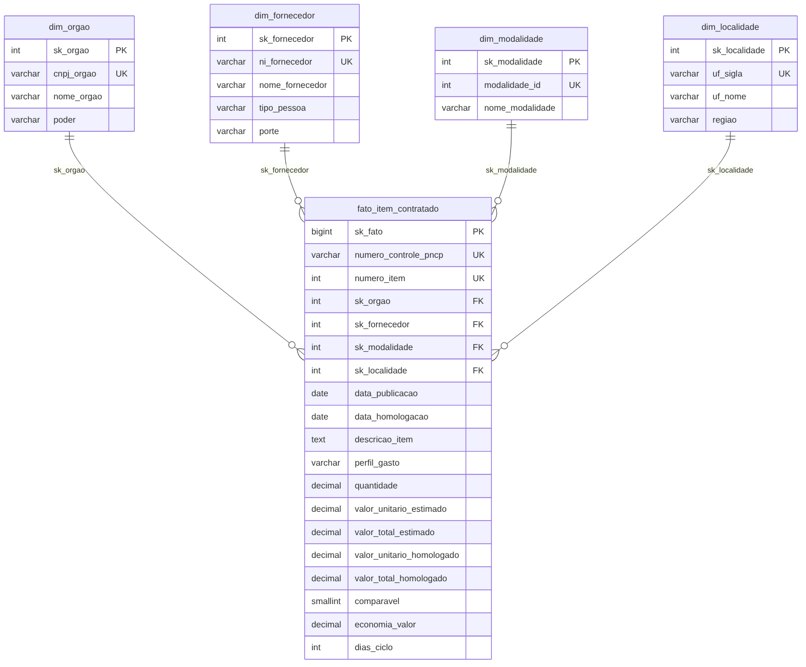
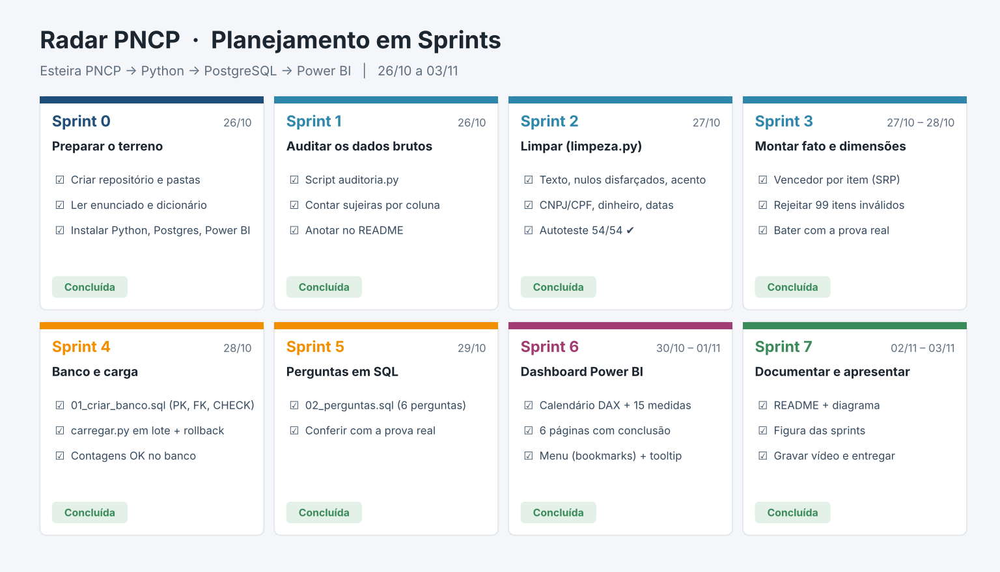

# Radar PNCP — compras públicas federais sob a lupa

Projeto de conclusão do Módulo 2 do curso **Análise de Dados com Python – PostgreSQL**.

📺 **Vídeo da apresentação:** _[cole aqui o link do Google Drive]_

---

## 1. O problema

A Controladoria quer saber onde está o dinheiro das compras públicas federais: quanto se economiza, quem concentra os contratos, quais modalidades funcionam melhor, onde as compras demoram e em que o dinheiro vai. O problema é que a base que sai do PNCP vem bem suja: CNPJ com máscara e sem o zero da frente, dinheiro escrito como texto ("R$ 1.693,46", "(500,00)"), datas em 7 formatos diferentes no mesmo campo, acento quebrado, "N/A" e "SEM INFORMAÇÃO" fingindo ser dado e homologação com data anterior à publicação do edital. Do jeito que vem, ninguém confia nos números.

O **Radar PNCP** é uma esteira que pega esses arquivos brutos, limpa, organiza num modelo estrela e entrega um dashboard que responde às 6 perguntas da Controladoria:

```
PNCP (CSVs brutos) → Python (auditoria + limpeza) → PostgreSQL (Star Schema) → Power BI (dashboard)
```

Base usada: amostra de contratações federais publicadas no PNCP em 2025 (02/01/2025 a 31/12/2025), já extraída em `data/raw/`. Usei o ano inteiro, sem filtro.

---

## 2. Estrutura das pastas

```
├── data/
│   ├── raw/                 # CSVs brutos do PNCP (não mexo neles)
│   └── processed/           # tabelas limpas geradas pelo pipeline (fora do Git, dá pra gerar de novo)
├── src/
│   ├── config.py            # caminhos e credenciais (lidas do .env)
│   ├── banco.py             # conexão e funções do PostgreSQL
│   ├── auditoria.py         # raio-x da base suja (só conta, não altera)
│   ├── limpeza.py           # funções de limpeza + autoteste
│   ├── montar_tabelas.py    # regras de negócio → fato + 4 dimensões
│   └── carregar.py          # carga em lote no PostgreSQL
├── sql/
│   ├── 01_criar_banco.sql   # criação do Star Schema (PK, FK, UNIQUE, CHECK)
│   └── 02_perguntas.sql     # as 6 perguntas de negócio
├── powerbi/
│   └── radar_pncp.pbix      # dashboard
├── docs/
│   ├── img/                 # sprints.png e modelo_estrela.png
│   └── powerbi/             # calendario.dax, medidas.dax e o tema de cores (.json)
├── reports/
│   └── auditoria.txt        # saída do script de auditoria
├── .env.example             # modelo das credenciais (o .env de verdade não vai pro Git)
├── requirements.txt
└── README.md
```

---

## 3. Como rodar do zero

**Precisa ter:** Python 3.10+, PostgreSQL 14+ (com pgAdmin) e Power BI Desktop. Testei no Windows 11.

```bash
# 1) baixar o projeto
git clone https://github.com/<seu-usuario>/radar-pncp.git
cd radar-pncp

# 2) ambiente e bibliotecas
python -m venv .venv
.venv\Scripts\activate          # no Linux/Mac: source .venv/bin/activate
pip install -r requirements.txt

# 3) credenciais do banco: copie o modelo e coloque a sua senha do PostgreSQL
copy .env.example .env          # no Linux/Mac: cp .env.example .env

# 4) pipeline, nessa ordem
python -m src.auditoria         # raio-x da base suja (opcional, só pra ver os problemas)
python -m src.limpeza           # autoteste das funções: tem que dar 54 de 54 ✔
python -m src.montar_tabelas    # gera data/processed/ e mostra a conferência com a prova real
python -m src.carregar          # recria o banco, cria as tabelas e carrega tudo
```

Depois disso:
- **SQL:** abre o `sql/02_perguntas.sql` no pgAdmin (banco `pncp_controladoria`) e roda cada consulta.
- **Power BI:** abre o `powerbi/radar_pncp.pbix`. Se a senha ou o servidor forem diferentes, ajusta em *Transformar dados → Configurações da fonte de dados*.

> O `carregar.py` apaga e recria o banco `pncp_controladoria` toda vez que roda. Dá pra rodar quantas vezes quiser, o resultado é sempre o mesmo.

---

## 4. Antes de limpar: o que encontrei nos dados (auditoria)

Rodei o `src/auditoria.py` antes de tratar qualquer coisa (saída completa em `reports/auditoria.txt`).

| Pergunta do enunciado | Resposta |
|---|---|
| Quantas linhas em cada arquivo? | compras 2.042 · itens 7.077 · resultados 15.896 |
| Tem `numero_controle_pncp` repetido em compras? | Não (0) |
| Formatos de data? | 7 formatos no mesmo campo: `AAAA-MM-DD`, `AAAA-MM-DDThh:mm:ss`, `DD/MM/AAAA`, `DD/MM/AAAA hh:mm`, `DD-MM-AAAA`, `DD.MM.AAAA`, `AAAA/MM/DD` e `AAAAMMDD` |
| Formatos de dinheiro? | `R$ 1.693,46`, `20.307.804,45`, `6769268.15`, `R$ 3,00 ` (com espaço sobrando) |
| Formatos de CNPJ? | com máscara (`51.593.855/0001-04`), só dígitos e sem o zero da frente |
| Acento quebrado? | Sim: `nome_unidade` (176), `objeto_compra` (173), `descricao` (223), `nome_fornecedor` (4) |
| `data_resultado` antes de `data_publicacao`? | Sim: 234 resultados |

### Dicionário das inconsistências tratadas

| # | Problema | Exemplo | Onde / quantos | Como tratei |
|---|---|---|---|---|
| 1 | CNPJ/CPF com máscara | `51.593.855/0001-04` | 176 `cnpj_orgao` · 1.633 `ni_fornecedor` | Fico só com os dígitos (`limpar_documento`) |
| 1 | Zero da esquerda perdido | `1222333000181` (13 dígitos) | 77 órgãos · 194 fornecedores PJ · 159 PF | `zfill`: completo até 14 (PJ) ou 11 (PF) dígitos |
| 1 | Mistura de tipos de pessoa | PJ, PF e PE (estrangeiro) | 11.344 PJ · 4.531 PF · 21 PE | O tamanho depende do tipo. Estrangeiro (PE) não é CNPJ, então fica como veio |
| 2 | Dinheiro em texto | `R$ 1.693,46` | ~1.600 por coluna nos itens, ~3.600 nos resultados | `converter_numero`: tira R$ e espaços e descobre qual é o separador decimal |
| 2 | Separador ambíguo | `0,754` e `746.815` | quantidades e valores | Ponto ou vírgula **sozinho** é sempre decimal; só o repetido é milhar; com os dois, o último é o decimal |
| 2 | Negativo de 3 jeitos | `(1.500,00)`, `-12,50`, `1.500,00-` | — | Identifico o sinal e devolvo o número negativo (depois o item cai na rejeição) |
| 3 | Várias máscaras de data | `20250310`, `10.03.2025`… | todas as datas | `converter_data` testa formato por formato e descarta a hora |
| 3 | Data impossível | `31/02/2025`, `0001-01-01` | — | Vira vazio (só aceito anos entre 2000 e 2030) |
| 3 | Homologação antes da publicação | — | 234 resultados (230 itens na fato) | A data de homologação vira vazio e o item fica sem ciclo, mas continua na fato |
| 4 | Nulos disfarçados | `N/A`, `NULL`, `-`, `SEM INFORMAÇÃO`, `NÃO SE APLICA` | `porte` 4.893 · `modo_disputa` 967 · `criterio_julgamento` 1.883… | Viram vazio de verdade (None/NULL) |
| 4 | O "0" | `0` | — | Em campo de **texto** é nulo, em campo de **número** é zero mesmo (`zero_eh_nulo`) |
| 5 | Acento quebrado | `Aquisição` | ~580 textos | Desfaço a leitura errada: `encode('latin-1').decode('utf-8')` |
| 5 | Mesmo nome escrito de vários jeitos | `Ministério da Saúde` × `MINISTÉRIO  DA SAÚDE ` | 440 nomes de órgão → 352 | `padronizar_nome`: maiúsculas, espaço único, hífen padronizado |
| 5 | Caracteres invisíveis | espaço de largura zero | — | Removo antes de comparar |
| — | `categoria_item` inútil | `Não se aplica` | 7.077 de 7.077 | Ignorei. O perfil do gasto sai de `material_ou_servico` + palavras-chave |

---

## 5. Regras de negócio aplicadas

As regras vieram da Controladoria e eu implementei do jeito que foram passadas (é com elas que os números batem com a prova real).

1. **Grão da fato:** 1 linha por item (`numero_controle_pncp` + `numero_item`). O banco garante com `UNIQUE`.
2. **Um vencedor por item:** primeiro **descarto os cancelados** e só depois pego o 1º colocado (menor `ordem_classificacao_srp`; vazio vale 1). Empate: menor `sequencial_resultado`, lido como número. A ordem importa: se eu escolhesse o 1º antes de tirar os cancelados, uns 60 itens perderiam o vencedor em vez de passar a vaga pro 2º colocado.
3. **Só itens com resultado:** 852 itens não têm resultado válido e ficam de fora (não contam como rejeitados).
4. **Itens rejeitados (99):** dos 6.225 itens com resultado, rejeito os que têm dado impossível. Contei pelo **primeiro** motivo de cada um:

   | Motivo | Itens |
   |---|---|
   | quantidade vazia ou ≤ 0 | 1 |
   | valor unitário estimado ausente ou ≤ 0 | 23 |
   | valor unitário homologado ausente ou ≤ 0 | 6 |
   | orçamento sigiloso | 0 (nenhum dos 54 sigilosos tem resultado válido, então já saíram na regra 3) |
   | valor total estimado < R$ 1 | 59 |
   | homologado mais de 1.000× o estimado | 7 |
   | algum total acima de R$ 1 trilhão | 3 |
   | **Total** | **99** |

5. **Valores:** `valor_total = valor_unitário × quantidade`, usando a **quantidade homologada** (se vier vazia ou 0, uso a do item) **nos dois**, estimado e homologado, pra comparação ser justa.
6. **Comparável e economia:** comparável = não é Credenciamento **e** homologado ÷ estimado entre 0,1 e 10. A economia só existe nos comparáveis. Nos outros, `economia_valor` fica **vazio** (NULL), e não 0: assim fica claro que "não dá pra comparar" é diferente de "economizou zero".
7. **Cronologia:** homologação antes da publicação → sem data de homologação e sem ciclo. Comparo só a data, sem hora: homologar no mesmo dia vale (ciclo 0).
8. **Perfil do gasto:** `Material` → Bens, `Serviço` → Serviços. Se a descrição do item **ou** o objeto da compra tiver uma das palavras **obra(s), construção, reforma, engenharia** (palavra inteira, com `\b`), vira **Obras e engenharia**, e isso tem prioridade. Sem o `\b`, "co**bra**nça" e "d**obra**diça" virariam obra.
9. **Modalidade:** o nome sai do `modalidade_id`, não do texto do arquivo.
10. **Órgão:** CNPJ limpo como o do fornecedor; nome padronizado. No ranking de ciclo agrupo pelo **nome** (o mesmo órgão tem várias unidades/CNPJ) e mostro só quem tem 5+ itens com ciclo.
11. **Região:** montada a partir da UF (o arquivo não traz).
12. **Separadores numéricos:** ponto ou vírgula sozinho = decimal. Sem isso, o volume pulava de R$ 8 bi pra uns R$ 31 bi.

**Uma discordância (não mudei a regra, só anoto):** a regra 4 manda rejeitar item com estimado total < R$ 1. Tem item barato de verdade (uma arruela, um parafuso) que pode custar centavos, e ele sai junto. Eu preferiria olhar o valor **unitário** junto com a quantidade antes de descartar.

---

## 6. Modelo de dados (Star Schema)



| Tabela | Papel | Linhas |
|---|---|---|
| `fato_item_contratado` | **o que** foi comprado: números de cada item com o vencedor | 6.126 |
| `dim_orgao` | **quem comprou** (1 linha por CNPJ de unidade compradora) | 363 |
| `dim_fornecedor` | **quem vendeu** (1 linha por CNPJ/CPF) | 2.652 |
| `dim_modalidade` | **como** comprou | 7 |
| `dim_localidade` | **onde** (UF + região) | 27 |
| `Calendario` | **quando** (só no Power BI, em DAX) | — |

**Por que estrela e não um tabelão?** Os números ficam todos num lugar só (a fato) e as descrições em tabelas pequenas, sem repetir o nome do fornecedor 6 mil vezes. Fica mais leve, mais fácil de manter e é exatamente o formato que o Power BI espera: filtro sai da dimensão e cai na fato.

**Decisões no banco (`sql/01_criar_banco.sql`):**
- **Chave substituta (`sk_...`)** em toda tabela: um número inteiro só do banco. Se o CNPJ mudar de formato amanhã, as ligações não quebram, e juntar por inteiro é mais rápido que por texto.
- **Chave natural com `UNIQUE`** (`cnpj_orgao`, `ni_fornecedor`, `modalidade_id`, `uf_sigla`): impede que o mesmo fornecedor apareça duas vezes.
- **`UNIQUE (numero_controle_pncp, numero_item)`** na fato: garante o grão (1 linha por item).
- **FK** da fato para as 4 dimensões: não existe item apontando pra fornecedor que não existe.
- **Linha "Não informado" (`sk = -1`)** em cada dimensão: se algum item chegar sem órgão, fornecedor, modalidade ou UF, ele aponta pra `-1` em vez de ficar com FK solta. O `-1` fica fora da sequência 1, 2, 3…, então nunca colide. Nesta base não precisou, mas a rede de segurança está lá.
- **`CHECK`** como segunda barreira: quantidade > 0, nenhum valor negativo, `comparavel` só 0 ou 1, perfil só nos 3 valores, ciclo ≥ 0, homologação nunca antes da publicação e economia só em item comparável.
- **Tipos:** dinheiro `DECIMAL(18,2)`, preço unitário e quantidade `DECIMAL(18,4)`. Nunca `float`, que arredonda centavo.

**A carga (`src/carregar.py`):**
- valida **antes** de gravar (chave repetida para tudo; FK sem destino vai pra `-1` com aviso);
- recria o banco e roda o `01_criar_banco.sql` sozinha, sem precisar abrir o pgAdmin;
- insere **em lote** (`execute_values`, milhares de linhas por comando), dimensões primeiro e fato depois;
- tudo numa **transação só**: se qualquer linha falhar (um `CHECK`, por exemplo), faz `rollback` e não fica banco pela metade. Testei isso colocando uma quantidade negativa de propósito: o banco barrou no `ck_quantidade` e nada foi gravado;
- no fim confere as contagens com a prova real.

---

## 7. Respostas das 6 perguntas

Consultas em `sql/02_perguntas.sql` e as mesmas respostas no dashboard (as medidas estão em `docs/powerbi/medidas.dax`).

| # | Pergunta | Resposta |
|---|---|---|
| 1 | Quanto o governo economizou? | **R$ 992,9 milhões**, ou **14,46%** sobre um estimado comparável de R$ 6,87 bi. 89% dos itens entram nessa conta. 27 itens saíram mais caros que o estimado. |
| 2 | Quem concentra o orçamento? | Os **10 maiores fornecedores levam 41,4%** de todo o volume. Só o 1º (NOW SEGUROS SA) leva 13,2% com **um único item** de R$ 1,06 bi. A lista é dominada por construtoras. |
| 3 | Qual modalidade economiza mais e qual movimenta mais? | **Pregão Eletrônico** tem o maior deságio (**24,0%**, ~9,6 p.p. acima da média). **Concorrência Eletrônica** movimenta mais (**58,4%** do volume). Credenciamento (26,6% do volume) não tem economia calculável, e isso é esperado. |
| 4 | Quanto tempo do edital à homologação? | Média de **48,1 dias**, máximo de **611**. 230 itens ficaram sem ciclo (data inválida). Mais lentos (com 5+ itens): Universidade Federal de Campina Grande (266 dias), CONFEA (223) e DNIT (156, com 12 unidades). |
| 5 | Onde se gasta mais e onde se consegue mais desconto? | **Centro-Oeste** concentra **44,3%** do volume (só o DF tem 39%, efeito das sedes em Brasília). Melhor desconto: **Norte (21,4%)**. Pior: **Sul (8,0%)**. |
| 6 | Bens, serviços ou obras? | **Obras e engenharia: 60,8%** do volume com só 967 itens (ticket médio de R$ 5,1 mi). Serviços 36,6% e Bens 2,6%, apesar de Bens ser mais da metade dos itens (3.310). |

---

## 8. Power BI

- **Calendário em DAX** (`docs/powerbi/calendario.dax`), com limites vindos dos dados, mês ordenado pelo número, Ano-Mês ordenado por AAAAMM e marcado como tabela de datas. Ligado às duas datas da fato: publicação (ativa) e homologação (inativa, usada com `USERELATIONSHIP`). A hierarquia automática de data está desligada.
- **15 medidas obrigatórias + extras**, todas na tabela `_Medidas`, separadas em pastas por pergunta (P1 a P6), com `VAR/RETURN`, `CALCULATE`, `DIVIDE`, `RANKX`, `TOPN`, `KEEPFILTERS` e iteradoras (`SUMX`, `AVERAGEX`).
- **6 páginas**, uma por pergunta, sempre na mesma estrutura: **pergunta → números → conclusão**.
- **Menu retrátil** com botões e indicadores (bookmarks) e **página de tooltip** com título dinâmico.
- **Design:** tema próprio (`docs/powerbi/tema_controladoria.json`), grid alinhado, azul como cor principal e laranja só pra destacar o que importa (leitura em Z: KPIs no topo, detalhe embaixo, conclusão no rodapé).

---

## 9. Planejamento (Sprints)



| Sprint | Objetivo | Entregável | O que mudou no caminho |
|---|---|---|---|
| 0 | Preparar o terreno | repositório, pastas, ambiente | Ia rodar no Mac, mas o Power BI Desktop só existe pra Windows. Passei tudo pro notebook Windows. |
| 1 | Auditar | `auditoria.py` + tabela da seção 4 | Não estava no kit: criei pra ter os números das sujeiras antes de limpar. |
| 2 | Limpar | `limpeza.py` com 54/54 ✔ | — |
| 3 | Montar tabelas | fato + 4 dimensões batendo com a prova real | Decidi deixar `economia_valor` vazio (e não 0) nos não comparáveis. Incluí a contagem dos motivos de rejeição. |
| 4 | Banco e carga | `01_criar_banco.sql` + `carregar.py` | Mudei a carga pra uma transação única com rollback (antes cada tabela confirmava sozinha) e incluí a validação prévia e a linha `-1`. |
| 5 | Perguntas SQL | `02_perguntas.sql` | — |
| 6 | Power BI | `.pbix` com 6 páginas, menu e tooltip | — |
| 7 | Documentar e apresentar | README, figuras, vídeo | — |

---

## 10. Tecnologias

Python 3 (pandas, psycopg2) · PostgreSQL 16 + pgAdmin 4 · Power BI Desktop (DAX) · Git/GitHub · VS Code

---

## 11. Melhorias futuras

- **Extração automática** direto da API do PNCP (`/api/consulta/`), em vez de CSV baixado na mão, com **agendamento** (rodar todo mês sozinho).
- **Carga incremental:** hoje o banco é recriado do zero, o que funciona com 6 mil linhas mas não com milhões.
- **Testes automatizados** com `pytest` para as regras do `montar_tabelas` (hoje só as funções de limpeza têm autoteste).
- **Alerta de sobrepreço:** comparar o preço unitário do mesmo item (pelo código do catálogo) entre órgãos diferentes.
- **Grupos econômicos:** juntar filiais pelo CNPJ raiz (8 primeiros dígitos) pra medir a concentração real, porque hoje cada filial conta como fornecedor diferente.
- **Separar serviços continuados de eventuais** no perfil do gasto.
- **Padronizar unidades de medida** (`UNIDADE`, `UN`, `UND`…) pra permitir comparar preço unitário.
- **Publicar o dashboard** no Power BI Service com atualização agendada.
